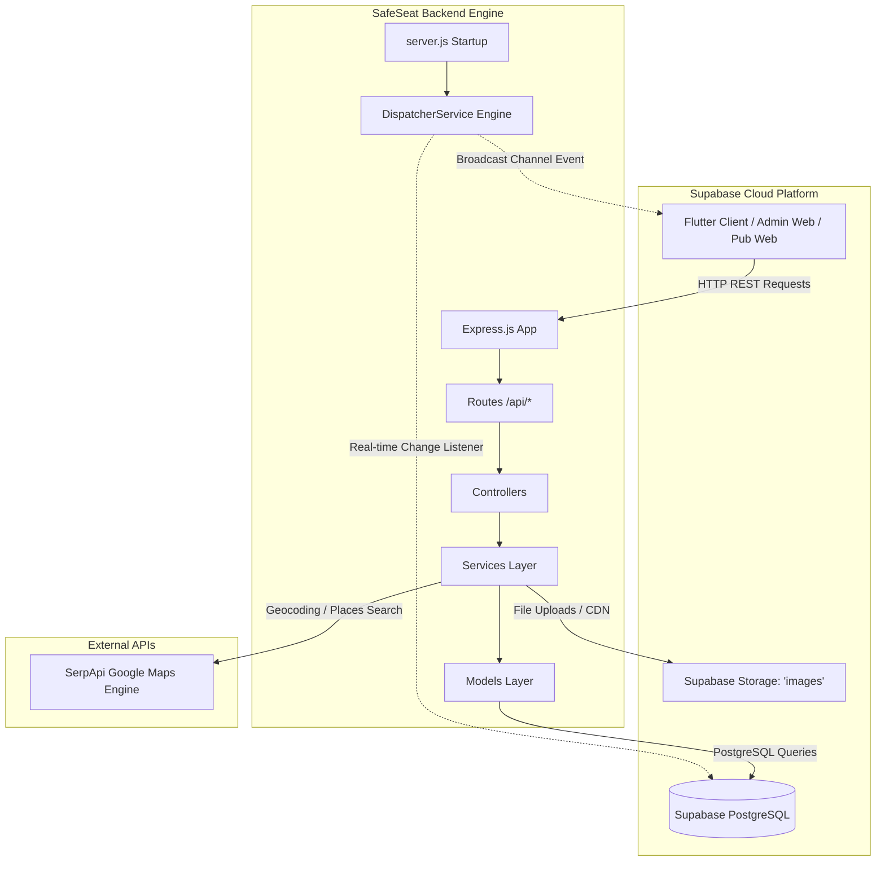

# 🚗 SafeSeat Backend API & Dispatcher Engine

[](https://nodejs.org/)
[](https://expressjs.com/)
[](https://supabase.com/)
[](LICENSE)

ระบบ Backend RESTful API และ Real-Time Dispatcher อัตโนมัติสำหรับแพลตฟอร์ม **SafeSeat** (บริการคนขับรถแทนสำหรับผู้สัญจรยามค่ำคืนและผู้ดื่มแอลกอฮอล์ เพื่อความปลอดภัยและลดอุบัติเหตุบนท้องถนน) รองรับการทำงานร่วมกันระหว่าง **ผู้ใช้งานทั่วไป (Customer/User)**, **ทีมคนขับบัดดี้ (Driver Buddy)**, **สถานบันเทิง/ร้านอาหาร (Pub Partner)** และ **ผู้ดูแลระบบ (Admin)**

---

## 📌 สารบัญ (Table of Contents)
1. [ภาพรวมของระบบ (System Overview)](#-ภาพรวมของระบบ-system-overview)
2. [สถาปัตยกรรมระบบ (System Architecture)](#-สถาปัตยกรรมระบบ-system-architecture)
3. [ฟีเจอร์เด่นและระบบอัจฉริยะ (Core Features)](#-ฟีเจอร์เด่นและระบบอัจฉริยะ-core-features)
4. [โครงสร้างฐานข้อมูล (Database Schema)](#-โครงสร้างฐานข้อมูล-database-schema)
5. [โครงสร้างไดเรกทอรี (Directory Structure)](#-โครงสร้างไดเรกทอรี-directory-structure)
6. [เอกสาร API Endpoints ทั้งหมด (API Reference)](#-เอกสาร-api-endpoints-ทั้งหมด-api-reference)
7. [การติดตั้งและเริ่มต้นใช้งาน (Getting Started)](#-การติดตั้งและเริ่มต้นใช้งาน-getting-started)
8. [ตัวแปรสภาพแวดล้อม (Environment Variables)](#-ตัวแปรสภาพแวดล้อม-environment-variables)
9. [สคริปต์เพิ่มเติม (Utility Scripts)](#-สคริปต์เพิ่มเติม-utility-scripts)

---

## 🌟 ภาพรวมของระบบ (System Overview)

SafeSeat แก้ปัญหาการขับขี่ยานพาหนะขณะมึนเมาด้วยโมเดลการให้บริการ **บัดดี้คู่หู 2 คน (Buddy Team)**:
- **Leader (หัวหน้าทีม):** ทำหน้าที่ขับรถของลูกค้าพาลูกค้าไปส่งยังจุดหมายปลายทางอย่างปลอดภัย
- **Follower (ผู้ติดตาม):** ขี่รถจักรยานยนต์หรือยานพาหนะคุ้มกันตามหลัง เพื่อไปรับหัวหน้าทีมกลับหลังเสร็จสิ้นภารกิจ

ระบบ Backend นี้รองรับ 4 ภาคส่วนหลัก:
1. **User (ลูกค้า):** ค้นหาสถานที่ปลายทาง, เรียกรถคนขับแทน, เลือก Lady Mode, บันทึกข้อมูลรถส่วนตัว (usercar), จัดการ SafeSeat Wallet และรีวิวคนขับ
2. **Driver (คนขับ):** สมัครสมาชิกพร้อมตรวจสอบเอกสาร (ใบขับขี่, ประวัติอาชญากรรม, ใบรับรองแพทย์, ใบผ่านการอบรม), จับคู่ทีมบัดดี้, อัปเดตพิกัด GPS, รับงาน Real-time, อัปโหลดภาพหลักฐานจบงาน และถอนเงิน
3. **Pub (สถานประกอบการ/ร้านค้า):** สมัครเป็นพาร์ทเนอร์ร้านค้า, ให้บริการกดเรียกรถแทนลูกค้าในร้าน, ติดตามสถานะงาน และจำลองสเต็ปการเดินทาง
4. **Admin (ผู้ดูแลระบบ):** Dashboard สถิติ, ตรวจสอบและอนุมัติร้านค้าและคนขับ, จัดการรายงานความประพฤติและอุบัติเหตุ (Driver/User Reports)

---

## 🏗 สถาปัตยกรรมระบบ (System Architecture)

ระบบถูกออกแบบด้วยสถาปัตยกรรมแบบ **Layered Architecture (Routes ➔ Controllers ➔ Services ➔ Models ➔ Database & Storage)** เพื่อความยืดหยุ่นและการขยายตัวที่ง่ายในอนาคต



---

## ⚡ ฟีเจอร์เด่นและระบบอัจฉริยะ (Core Features)

### 1. ระบบจ่ายงานอัตโนมัติแบบเรียลไทม์ (Real-Time Automated Dispatcher)
ตั้งอยู่ที่ `src/services/dispatcherService.js` โดยทำงานเบื้องหลังทันทีที่ Server เริ่มต้น:
- **Postgres Real-Time Subscriptions:** ดักฟังการสร้างงานใหม่ในตาราง `requestbyuser` (สถานะ `กำลังค้นหาคนขับ`) และ `requestbypub` (สถานะ `รอคนขับ`)
- **Lady Mode Matching:** หากงานระบุเป็น Lady Mode ระบบจะคัดกรองเฉพาะทีมบัดดี้ที่สมาชิกทุกคน (ทั้ง Leader และ Follower) เป็นผู้หญิงเท่านั้น
- **Vehicle Skill Matching:** ตรวจสอบความเข้ากันได้ระหว่างประเภทเกียร์/รถของลูกค้า กับทักษะของ Leader (`driverskill`):
  - `EV (รถยนต์ไฟฟ้า)`
  - `Manual (เกียร์ธรรมดา/กระปุก)`
  - `Auto (เกียร์อัตโนมัติ)`
- **Haversine Distance Matching:** คำนวณระยะห่างระหว่างจุดรับของลูกค้ากับตำแหน่ง GPS ล่าสุดของทีมคนขับ (`currentloclat`, `currentloclng`) และส่งงานให้ทีมที่ใกล้ที่สุดในรัศมี
- **Real-Time Broadcast Dispatch:** ส่งแจ้งเตือนงานไปยังแอปพลิเคชันคนขับผ่าน Supabase Broadcast Channel: `team_room_{buddyteamid}`

### 2. โมเดลการเงินและการแบ่งรายได้ (Financial Settlement Model)
ใช้โมเดลแบ่งรายได้คล้าย Ride-hailing ชั้นนำ (เช่น Grab):
- **กรณีชำระผ่าน SafeSeat Wallet:**
  - หักเงินจากกระเป๋าเงินลูกค้า 100%
  - โอนเข้ากระเป๋า Leader: **40%**
  - โอนเข้ากระเป๋า Follower: **40%**
  - ระบบหักเป็นค่าคอมมิชชันแพลตฟอร์ม: **20%**
- **กรณีชำระด้วยเงินสด / QR PromptPay หน้ารถ:**
  - ลูกค้ารับเงินสดจากลูกค้าโดยตรงเต็ม 100%
  - ระบบหักคอมมิชชันจากกระเป๋า Leader: **10%**
  - ระบบหักคอมมิชชันจากกระเป๋า Follower: **10%**
  - (รวมเป็นค่าคอมมิชชันเข้าระบบ 20%)

### 3. ระบบจัดเก็บเอกสารและรูปภาพ (Supabase Storage)
ตั้งอยู่ที่ `src/utils/supabaseStorage.js`:
- จัดการอัปโหลดไฟล์ผ่าน Multer ลงที่พักไฟล์ชั่วคราว (`uploads/`)
- ส่งต่อไปยัง **Supabase Storage** บักเก็ต `images` พร้อมตั้งชื่อไฟล์แบบ Unique Hash สั้น
- ลบไฟล์ Temp จากเครื่องเซิร์ฟเวอร์อัตโนมัติเพื่อไม่ให้เปลืองพื้นที่
- โครงสร้างโฟลเดอร์ใน Bucket:
  - `drivers/profile`: ภาพโปรไฟล์คนขับ
  - `drivers/cars`: ภาพรถยนต์/ยานพาหนะของคนขับ
  - `drivers/documents`: เอกสารการสมัคร (ใบขับขี่, ประวัติอาชญากรรม, ใบรับรองแพทย์, ใบประกาศอบรม 1-4)
  - `pubs/profile`: เอกสารใบอนุญาตสถานบันเทิง
  - `pubs/storefront`: รูปหน้าร้านสถานบันเทิง
  - `requests/evidence`: รูปถ่ายหลักฐานส่งลูกค้าถึงที่หมายอย่างปลอดภัย
  - `reports/user`: รูปหลักฐานแจ้งเหตุพฤติกรรมลูกค้า

---

## 🗄 โครงสร้างฐานข้อมูล (Database Schema)

ตารางหลักที่เชื่อมต่อผ่าน Supabase PostgreSQL:

| ตาราง (Table) | หน้าที่และความสัมพันธ์ (Description) |
|---|---|
| `User` | ข้อมูลลูกค้าทั่วไป, เบอร์โทรศัพท์, รหัสผ่าน (bcrypt), ยอดเงินใน SafeSeat Wallet |
| `driver` | ข้อมูลคนขับ, ยานพาหนะ, สถานะการอนุมัติ (`registerstatus`), ยอดเงินในกระเป๋าคนขับ |
| `pub` | ข้อมูลสถานบันเทิงพาร์ทเนอร์, พิกัดร้าน, สถานะการอนุมัติ (`regisstatus`) |
| `admin` | ข้อมูลบัญชีผู้ดูแลระบบ (รองรับทั้ง Plain Text และ bcrypt hash) |
| `buddyteam` | ข้อมูลทีมบัดดี้คนขับ (`leaderid`, `followerid`, พิกัดล่าสุด, สถานะ `Ready`/`Busy`) |
| `usercar` | ข้อมูลรถส่วนตัวของลูกค้า (`usercarid`, `carbrand`, `carmodel`, `carplate`, `car_type`) |
| `cartype` | ประเภทรถยนต์ (EV, เกียร์ธรรมดา, เกียร์ออโต้) |
| `driverskill` | ทักษะประเภทรถที่คนขับแต่ละคนสามารถขับได้ |
| `requestbyuser` | รายการเรียกคนขับจากลูกค้าทั่วไป (พิกัดรับ-ส่ง, ราคา, สถานะงาน, buddy_team_id) |
| `requestbypub` | รายการเรียกคนขับจากสถานบันเทิง (พิกัดร้านค้า, เบอร์ลูกค้า, เบอร์ฉุกเฉิน) |
| `review` | รีวิวและคะแนนความพึงพอใจที่ลูกค้าให้แก่คนขับ |
| `wallettransaction` | บันทึกประวัติการเติมเงิน การรับค่ารอบ การหักคอมมิชชัน และการถอนเงิน |
| `driverreport` | รายงานอุบัติเหตุหรือปัญหาที่เกิดกับคนขับระหว่างปฏิบัติหน้าที่ |
| `userreport` | รายงานพฤติกรรมที่ไม่เหมาะสมของลูกค้าส่งถึง Admin |

---

## 📁 โครงสร้างไดเรกทอรี (Directory Structure)

```text
safeseat_backend/
├── .env                     # ไฟล์ Configuration สภาพแวดล้อมจริง (ห้ามคอมมิตขึ้น Git)
├── .env.example             # ไฟล์ตัวอย่าง Configuration สำหรับการ Setup
├── .gitignore               # กำหนดไฟล์ที่ไม่ต้องการติดตามใน Git
├── hash_passwords.js        # สคริปต์สร้าง bcrypt hash สำหรับข้อมูล Mock Data
├── package.json             # ข้อมูลโปรเจกต์และ Dependency
├── uploads/                 # โฟลเดอร์พักไฟล์อัปโหลดชั่วคราวก่อนส่งขึ้น Supabase
└── src/
    ├── server.js            # จุดเริ่มต้นเซิร์ฟเวอร์ (Listen PORT & Start Dispatcher)
    ├── app.js               # Express Application, Middleware & Route Configuration
    ├── config/
    │   └── supabase.js      # การเชื่อมต่อ Supabase Client หลัก
    ├── controllers/
    │   ├── admin/
    │   │   └── adminController.js         # ควบคุมแดชบอร์ด อนุมัติคนขับ/ร้านค้า
    │   ├── driver/
    │   │   ├── authController.js          # เข้าสู่ระบบ สมัครคนขับ อัปโหลดเอกสาร
    │   │   ├── buddyRequestController.js  # เชิญคู่หู จัดการสถานะทีม
    │   │   ├── driverReportController.js  # รายงานเหตุคนขับ
    │   │   ├── jobController.js           # รับงาน จบงาน แนบรูปหลักฐาน
    │   │   ├── userController.js          # ค้นหาคนขับ/โปรไฟล์
    │   │   ├── userReportController.js    # แจ้งรายงานลูกค้า
    │   │   ├── vehicleController.js       # จัดการยานพาหนะคนขับ
    │   │   └── walletController.js        # ยอดเงิน ถอนเงิน ประวัติธุรกรรม
    │   ├── pub/
    │   │   ├── pub.controller.js          # ยืนยันตัวตนร้านค้าและโปรไฟล์
    │   │   └── service.controller.js      # เรียกรถแทนลูกค้า จำลองขั้นตอน
    │   └── user/
    │       ├── auth.controller.js         # เข้าสู่ระบบ สมัครสมาชิกลูกค้า
    │       ├── location.controller.js     # ค้นหาพิกัดสถานที่
    │       ├── profile.controller.js      # โปรไฟล์ รถของฉัน เติมเงิน Wallet
    │       ├── request.controller.js      # ส่งคำขอเรียกรถ ยกเลิก ตรวจสอบสถานะ
    │       └── review.controller.js       # ให้คะแนนรีวิวคนขับ
    ├── models/
    │   ├── driver/                        # โมเดลจัดการ Database ฝั่งคนขับ
    │   ├── pub/                           # โมเดลจัดการ Database ฝั่งสถานบันเทิง
    │   └── user/                          # โมเดลจัดการ Database ฝั่งลูกค้า
    ├── routes/
    │   ├── admin/adminRoutes.js           # เส้นทาง API ผู้ดูแลระบบ
    │   ├── driver/                        # เส้นทาง API ฝั่งคนขับ (8 โมดูล)
    │   ├── pub/pub.route.js               # เส้นทาง API ฝั่งสถานบันเทิง
    │   ├── user/                          # เส้นทาง API ฝั่งลูกค้า (5 โมดูล)
    │   └── searchRoute.js                 # ค้นหาสถานที่ผ่าน SerpApi Google Maps
    ├── services/
    │   ├── dispatcherService.js           # Engine จ่ายงานอัจฉริยะแบบ Real-Time
    │   ├── pub/pub.service.js             # Business Logic ฝั่งสถานบันเทิง
    │   └── user/                          # Business Logic ฝั่งลูกค้า
    └── utils/
        └── supabaseStorage.js             # ตัวช่วยอัปโหลดและจัดการไฟล์ Supabase Storage
```

---

## 📡 เอกสาร API Endpoints ทั้งหมด (API Reference)

ทุก Endpoint ขึ้นต้นด้วย Base URL: `http://localhost:3000` (หรือ Domain ของ Server)

### 1. ระบบยืนยันตัวตนคนขับ (Driver Authentication) — `/api/auth`
| Method | Endpoint | คำอธิบาย (Description) | รูปแบบข้อมูล (Payload) |
|---|---|---|---|
| `POST` | `/api/auth/login` | เข้าสู่ระบบคนขับ | JSON: `{ username, password }` |
| `POST` | `/api/auth/register` | สมัครเป็นคนขับ | `multipart/form-data`: ข้อมูลส่วนตัว + ไฟล์ใบขับขี่, ประวัติอาชญากรรม, ใบรับรองแพทย์, ใบผ่านอบรม |
| `POST` | `/api/auth/check-credentials` | ตรวจสอบ username, email, phone ซ้ำ | JSON: `{ username, email, phoneNo }` |
| `GET` | `/api/auth/status/:username` | ตรวจสอบสถานะการอนุมัติการสมัคร | Params: `username` |

### 2. โปรไฟล์และรถคนขับ (Driver Profile & Vehicle) — `/api/users` & `/api/vehicles`
| Method | Endpoint | คำอธิบาย (Description) | รูปแบบข้อมูล (Payload) |
|---|---|---|---|
| `GET` | `/api/users` | ค้นหารายชื่อคนขับสำหรับชวนเป็นบัดดี้ | Query: `?search=...` |
| `GET` | `/api/users/:username` | ดูข้อมูลโปรไฟล์คนขับ | Params: `username` |
| `PUT` | `/api/users/:username` | อัปเดตข้อมูลโปรไฟล์และรูปภาพ | `multipart/form-data` |
| `GET` | `/api/vehicles/:username` | ดูข้อมูลรถของคนขับ | Params: `username` |
| `PUT` | `/api/vehicles/:username` | แก้ไขข้อมูลรถและรูปถ่ายรถคนขับ | `multipart/form-data`: `frontImage`, `sideImage` |

### 3. กระเป๋าเงินคนขับ (Driver Wallet) — `/api/wallets`
| Method | Endpoint | คำอธิบาย (Description) | รูปแบบข้อมูล (Payload) |
|---|---|---|---|
| `GET` | `/api/wallets/:username/balance` | ตรวจสอบยอดเงินคงเหลือในกระเป๋า | Params: `username` |
| `GET` | `/api/wallets/:username/transactions` | ตรวจสอบประวัติการเงินทั้งหมด | Params: `username` |
| `POST` | `/api/wallets/:username/withdraw` | แจ้งถอนเงินออกจากระบบ | JSON: `{ amount, bankName, accountNumber }` |

### 4. การจัดการทีมบัดดี้และงาน (Buddy Team & Jobs) — `/api/buddy-team` & `/api/jobs`
| Method | Endpoint | คำอธิบาย (Description) | รูปแบบข้อมูล (Payload) |
|---|---|---|---|
| `POST` | `/api/buddy-team` | ส่งคำขอชวนเป็นบัดดี้ | JSON: `{ leaderId, followerId }` |
| `GET` | `/api/buddy-team/pending/:userId` | ดูรายการคำขอเป็นบัดดี้ที่รอตอบรับ | Params: `userId` |
| `PUT` | `/api/buddy-team/accept/:id` | ตอบรับคำขอและสร้างทีมบัดดี้ (สถานะ Ready) | Params: `id` (Request ID) |
| `PUT` | `/api/buddy-team/reject/:id` | ปฏิเสธคำขอเป็นคู่หู | Params: `id` |
| `GET` | `/api/buddy-team/active/:userId` | ดูข้อมูลทีมบัดดี้ที่กำลังทำงานอยู่ในปัจจุบัน | Params: `userId` |
| `GET` | `/api/buddy-team/recent/:userId` | ดูประวัติทีมที่เคยร่วมงานกันล่าสุด | Params: `userId` |
| `POST` | `/api/jobs/accept` | คนขับกดยอมรับงาน | JSON: `{ request_id, buddy_team_id, is_pub_job }` |
| `POST` | `/api/jobs/complete` | สิ้นสุดงาน, บันทึกรูปหลักฐาน และคิดเงิน | `multipart/form-data`: `evidenceImage` + `{ request_id, buddy_team_id, is_pub_job }` |

### 5. รายงานเหตุและความปลอดภัย (Driver & User Reports) — `/api/driver-reports` & `/api/user-reports`
| Method | Endpoint | คำอธิบาย (Description) | รูปแบบข้อมูล (Payload) |
|---|---|---|---|
| `GET` | `/api/driver-reports` | ดึงรายการรายงานของคนขับ | Query: `?driverId=...` |
| `GET` | `/api/driver-reports/check/:requestId` | ตรวจสอบว่างานนี้เคยแจ้งรายงานหรือยัง | Params: `requestId` |
| `POST` | `/api/driver-reports` | สร้างรายงานปัญหา/อุบัติเหตุของคนขับ | JSON: ข้อมูลรายงานเหตุการณ์ |
| `GET` | `/api/user-reports` | ดึงรายการรายงานพฤติกรรมลูกค้า | - |
| `POST` | `/api/user-reports` | สร้างรายงานแจ้งพฤติกรรมลูกค้า | `multipart/form-data`: `reportImage` + ข้อมูลรายงาน |

### 6. สถานบันเทิงและร้านอาหาร (Pub Management) — `/api/pub`
| Method | Endpoint | คำอธิบาย (Description) | รูปแบบข้อมูล (Payload) |
|---|---|---|---|
| `POST` | `/api/pub/login` | เข้าสู่ระบบร้านค้า | JSON: `{ username, password }` |
| `POST` | `/api/pub/register` | ลงทะเบียนร้านค้าพาร์ทเนอร์ | `multipart/form-data`: ใบอนุญาต + รูปหน้าร้าน |
| `POST` | `/api/pub/check-email` | ตรวจสอบอีเมลร้านค้าซ้ำ | JSON: `{ email }` |
| `GET` | `/api/pub/status/:username` | ตรวจสอบสถานะการอนุมัติร้านค้า | Params: `username` |
| `GET` | `/api/pub/profile/:username` | ดึงข้อมูลร้านค้า | Params: `username` |
| `POST` | `/api/pub/request-driver` | ร้านค้ากดเรียกรถคนขับแทนให้ลูกค้า | JSON: `{ pubUsername, custName, phoneNo, dropoffLatitude, ... }` |
| `GET` | `/api/pub/service-info/:username` | รายการคำขอทั้งหมดของร้านค้านี้ | Params: `username` |
| `GET` | `/api/pub/service-request/:requestId`| ดึงสถานะคำขอสำหรับ Polling หน้า Waiting | Params: `requestId` |
| `DELETE`| `/api/pub/service-request/:requestId`| ยกเลิกคำขอเรียกรถ | Params: `requestId` |
| `POST` | `/api/pub/service-request/:requestId/simulate-step` | จำลองขั้นตอนการเดินทาง (สำหรับทดสอบ) | JSON: `{ step }` |

### 7. ลูกค้าและผู้ใช้งานทั่วไป (End-User Services) — `/api/user/*`
| Method | Endpoint | คำอธิบาย (Description) | รูปแบบข้อมูล (Payload) |
|---|---|---|---|
| `POST` | `/api/user/auth/login` | เข้าสู่ระบบลูกค้า | JSON: `{ username, password }` |
| `POST` | `/api/user/auth/register` | สมัครสมาชิกลูกค้าใหม่ | JSON: ข้อมูลลูกค้า |
| `GET` | `/api/user/profile/:phoneNo` | ดูโปรไฟล์ลูกค้ารวมถึงยอดเงินในกระเป๋า | Params: `phoneNo` |
| `POST` | `/api/user/profile/update` | แก้ไขข้อมูลโปรไฟล์ลูกค้า | JSON: ข้อมูลที่ต้องการอัปเดต |
| `POST` | `/api/user/profile/topup` | เติมเงินเข้า SafeSeat Wallet | JSON: `{ phoneNo, amount }` |
| `GET` | `/api/user/profile/car/:phoneNo` | ดึงรายการรถส่วนตัวที่บันทึกไว้ | Params: `phoneNo` |
| `POST` | `/api/user/profile/car` | เพิ่มรถคันใหม่ของลูกค้า | JSON: `{ phoneNo, brand, model, plate, car_type }` |
| `DELETE`| `/api/user/profile/car/:usercarid` | ลบรถส่วนตัว | Params: `usercarid` |
| `GET` | `/api/user/profile/cartype/all` | ดึงประเภทรถทั้งหมด (EV, Manual, Auto) | - |
| `GET` | `/api/user/location/search` | ค้นหาสถานที่ปลายทางผ่าน SerpApi | Query: `?query=...` |
| `POST` | `/api/user/request` | ส่งคำขอเรียกรถคนขับแทน | JSON: ข้อมูลพิกัดรับส่ง, ประเภทรถ, Lady Mode |
| `GET` | `/api/user/request/user/:userId` | ดูประวัติการเรียกรถของลูกค้า | Query: `?type=active|completed|cancelled` |
| `GET` | `/api/user/request/:id` | ตรวจสอบสถานะการเดินทางของ Request | Params: `id` |
| `DELETE`| `/api/user/request/:id` | ยกเลิกคำขอเรียกรถ | Params: `id` |
| `POST` | `/api/user/review` | บันทึกคะแนนและรีวิวให้คนขับ | JSON: `{ requestId, rating, comment, ... }` |
| `GET` | `/api/user/review/check/:requestId` | ตรวจสอบว่าเคยรีวิวการเดินทางนี้แล้วหรือยัง | Params: `requestId` |

### 8. ผู้ดูแลระบบ (Admin Portal) — `/api/admin`
| Method | Endpoint | คำอธิบาย (Description) | รูปแบบข้อมูล (Payload) |
|---|---|---|---|
| `POST` | `/api/admin/login` | เข้าสู่ระบบผู้ดูแลระบบ | JSON: `{ username, password }` |
| `GET` | `/api/admin/stats` | สถิติจำนวนคนขับ, ร้านค้า, รายงานเหตุ | - |
| `GET` | `/api/admin/drivers` | ดึงรายชื่อคนขับทั้งหมดพร้อมเอกสาร | - |
| `GET` | `/api/admin/pubs` | ดึงรายชื่อร้านค้าสถานบันเทิงทั้งหมด | - |
| `PUT` | `/api/admin/drivers/:username/status`| อนุมัติ/ปฏิเสธ/ระงับบัญชีคนขับ | JSON: `{ status, note }` |
| `PUT` | `/api/admin/pubs/:username/status` | อนุมัติ/ปฏิเสธ/ระงับบัญชีร้านค้า | JSON: `{ status, note }` |
| `GET` | `/api/admin/driver-reports` | ดูรายงานเหตุการณ์ของคนขับทั้งหมด | - |
| `GET` | `/api/admin/user-reports` | ดูรายงานแจ้งพฤติกรรมลูกค้าทั้งหมด | - |
| `PUT` | `/api/admin/driver-reports/:id/status`| อัปเดตสถานะการตรวจสอบรายงานคนขับ | JSON: `{ status }` |
| `PUT` | `/api/admin/user-reports/:id/status`| อัปเดตสถานะการตรวจสอบรายงานลูกค้า | JSON: `{ status }` |

### 9. การค้นหาสถานที่ (Geocoding / Places) — `/api/search`
| Method | Endpoint | คำอธิบาย (Description) | รูปแบบข้อมูล (Payload) |
|---|---|---|---|
| `GET` | `/api/search/places` | ค้นหาสถานที่ผ่าน SerpApi Google Maps | Query: `?q=ชื่อสถานที่หรือพิกัด` |

---

## 🚀 การติดตั้งและเริ่มต้นใช้งาน (Getting Started)

### 1. ข้อกำหนดเบื้องต้น (Prerequisites)
- [Node.js](https://nodejs.org/) เวอร์ชัน 18.0.0 หรือใหม่กว่า
- บัญชี [Supabase](https://supabase.com/) ที่มีการตั้งค่าฐานข้อมูลและ Table Schema ครบถ้วน
- API Key จาก [SerpApi](https://serpapi.com/) (สำหรับบริการค้นหาสถานที่และ Geocoding)

### 2. การโคลนและติดตั้ง Dependencies
```bash
# นำทางเข้าสู่ไดเรกทอรี Backend
cd safeseat_backend

# ติดตั้งแพ็กเกจที่จำเป็น
npm install
```

### 3. ตั้งค่าสภาพแวดล้อม (Environment Configuration)
คัดลอกไฟล์ตัวอย่าง `.env.example` ไปเป็น `.env`:
```bash
cp .env.example .env
```
จากนั้นเปิดไฟล์ `.env` เพื่อกรอกข้อมูลจริง (ดูรายละเอียดที่หัวข้อถัดไป)

### 4. รันระบบเซิร์ฟเวอร์
```bash
# โหมดพัฒนา (Development Mode - พร้อม Hot Reload ด้วย Nodemon)
npm run dev

# โหมดใช้งานจริง (Production Mode)
npm start
```
เมื่อรันสำเร็จจะปรากฏข้อความบน Terminal:
```text
Server running on port 3000
[Dispatcher] 🟢 เริ่มต้นระบบดักจับงานจากผู้ใช้และร้านค้า...
```

---

## 🔐 ตัวแปรสภาพแวดล้อม (Environment Variables)

ค่า Config ในไฟล์ `.env`:

```env
# พอร์ตการทำงานของ Express Server
PORT=3000

# ข้อมูลการเชื่อมต่อไปยัง Supabase Project
SUPABASE_URL=https://your-project.supabase.co
SUPABASE_ANON_KEY=eyJhbGciOiJIUzI1NiIsInR5cCI6IkpXVCJ9...

# SerpApi API Key (ใช้สำหรับค้นหาสถานที่บน Google Maps)
SERP_API_KEY=your_serpapi_key_here
SERPAPI_API_KEY=your_serpapi_key_here
```

> **ข้อแนะนำ:** แนะนำให้ระบุทั้ง `SERP_API_KEY` และ `SERPAPI_API_KEY` เนื่องจากบางโมดูลเรียกใช้งานตัวแปรชื่อต่างกัน

---

## 🛠 สคริปต์เพิ่มเติม (Utility Scripts)

### สคริปต์เข้ารหัสผ่าน Mock Data (`hash_passwords.js`)
กรณีที่ต้องการเตรียมข้อมูล Mock Data ในตาราง `pub` หรือ `driver` บน Supabase โดยต้องการให้รหัสผ่านถูกแฮชด้วย `bcrypt`:
```bash
node hash_passwords.js
```
สคริปต์จะทำการสร้างคำสั่ง SQL `UPDATE ... SET password = '$2b$10$...'` ที่พร้อมนำไปคัดลอกและรันใน Supabase SQL Editor ได้ทันที

---

## 🛡 ความปลอดภัยและข้อแนะนำ (Security & Best Practices)

1. **การเก็บรหัสผ่าน:** รหัสผ่านของผู้ใช้งาน คนขับ ร้านค้า และแอดมินถูกแฮชด้วย `bcrypt` (10 Salt Rounds)
2. **การทำความสะอาดไฟล์ชั่วคราว:** ฟังก์ชันใน `supabaseStorage.js` จะลบไฟล์ Temp ออกจากไดเรกทอรี `uploads/` อัตโนมัติทุกครั้ง ไม่ว่าการอัปโหลดขึ้น Cloud จะสำเร็จหรือล้มเหลว
3. **ป้องกัน Memory Leak ใน Real-time Channel:** เมื่อ `DispatcherService` ทำการ Broadcast ส่งงานไปยังห้องทีมคนขับเสร็จสิ้น จะสั่ง `supabase.removeChannel(channel)` ทันที เพื่อป้องกันการเชื่อมต่อค้างในระบบ
4. **ความปลอดภัยของข้อมูล:** มีการซ่อนรหัสผ่าน (`delete data.password`) ก่อนส่ง Response กลับไปยัง Client ทุกครั้ง
